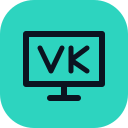
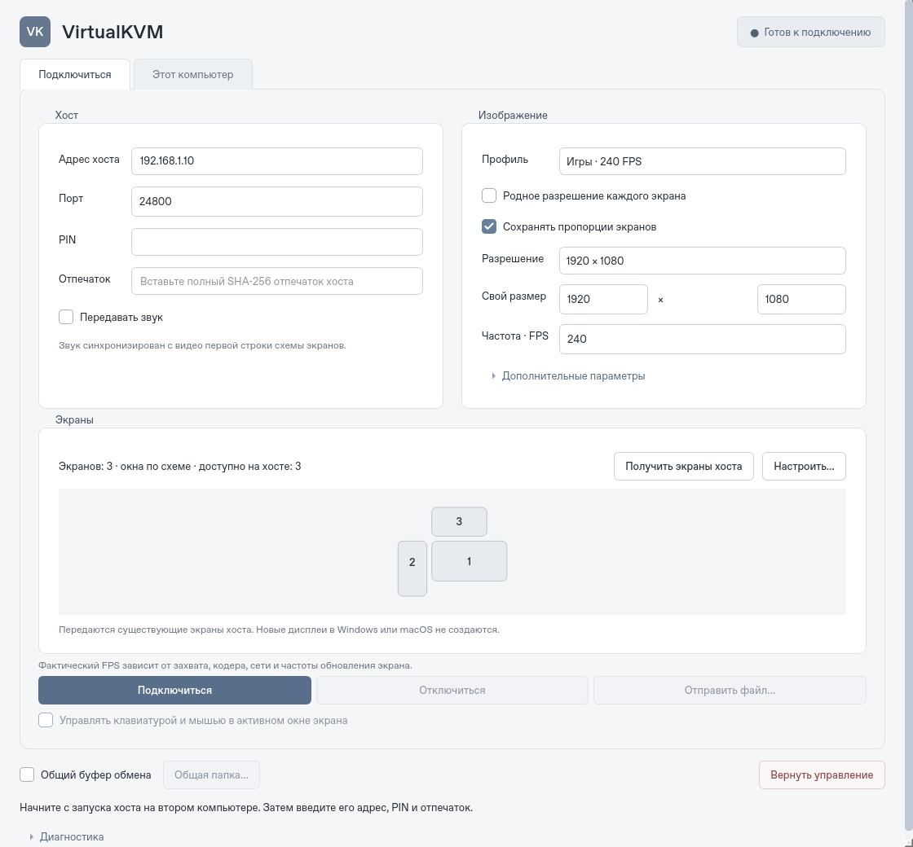
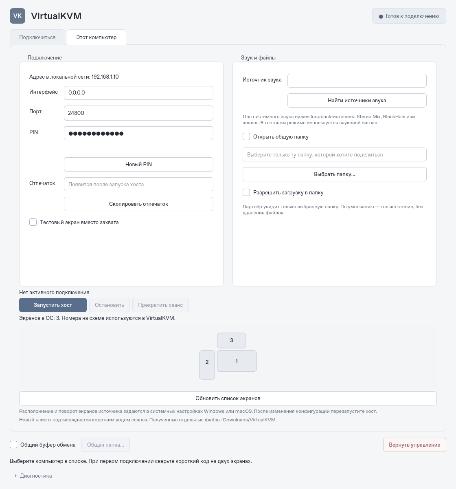

<div align="center">



<h1>VirtualKVM</h1>

<p><strong>Два компьютера. Одно рабочее место.</strong></p>
<p>Изображение, звук, клавиатура, мышь и файлы между Windows и macOS по локальной сети.</p>

<p>
  <a href="https://github.com/Suqesse/VirtualKVM/actions/workflows/ci.yml"></a>
  <a href="https://www.python.org/downloads/"></a>
  <a href="docs/TESTING.md"></a>
  <a href="LICENSE"></a>
</p>

<p>
  <a href="#быстрый-старт">Начать</a> ·
  <a href="docs/GUIDE.md">Руководство</a> ·
  <a href="docs/ARCHITECTURE.md">Архитектура</a> ·
  <a href="docs/TESTING.md">Проверки</a> ·
  <a href="https://github.com/Suqesse/VirtualKVM/actions">Сборки</a>
</p>



</div>

## Что умеет

| | Возможности |
| :--- | :--- |
| **Два экрана** | Отдельное окно для каждого монитора, полноэкранный режим, показатели получения и показа кадров. |
| **Изображение и звук** | H.264 / HEVC, AAC, синхронное A/V-воспроизведение и выбор доступного аппаратного кодера. |
| **Качество** | Профили «Игры · 240 FPS», «Работа · 60 FPS», «Качество · 4K», родное и пользовательское разрешение. |
| **Управление** | Клавиатура и мышь из активного окна, освобождение клавиш при потере фокуса, аварийный возврат управления. |
| **Файлы** | Передача файлов и браузер выбранной общей папки: чтение по умолчанию, запись по отдельному разрешению. |
| **Удобство** | Русский интерфейс, текстовый буфер обмена по выбору пользователя, сохранение профиля без PIN и ключей. |
| **Защита** | TLS с проверкой сертификата и PIN, зашифрованное SRT-видео, проверка SHA-256 при передаче файлов. |

**Статус: пилотная версия 0.1.0.** Цель — 240 FPS; фактическая частота зависит от захвата, разрешения, кодера, сети и мониторов. Поддержка параметра 240 FPS не означает подтверждённые два экрана 4K/240 FPS. [Что проверено →](docs/TESTING.md)

<details>
<summary><strong>Посмотреть режим хоста</strong></summary>



</details>

## Быстрый старт

### Установить приложение

Скачайте [установщик для Windows или Mac](https://github.com/Suqesse/VirtualKVM/releases): `.exe` для Windows, `.pkg` или `.dmg` для своей архитектуры Mac. Python и FFmpeg входят в установщик. [Пошаговая инструкция →](docs/INSTALLERS.md)

Нативные пакеты проходят сборку и проверку установки в [Installers](https://github.com/Suqesse/VirtualKVM/actions/workflows/installers.yml). Пилотные пакеты выпускаются без доверенной подписи, пока владелец проекта не добавит сертификаты.

### Запустить из исходников

Нужны **Python 3.11+** и **FFmpeg с SRT**. Установите FFmpeg по [инструкции для вашей ОС](docs/GUIDE.md#установка-из-исходников); `ffmpeg` и `ffprobe` должны быть доступны в `PATH`.

```bash
git clone https://github.com/Suqesse/VirtualKVM.git
cd VirtualKVM
```

Создайте и активируйте окружение:

<details>
<summary>Windows · PowerShell</summary>

```powershell
py -3 -m venv .venv
.\.venv\Scripts\Activate.ps1
```

</details>

<details>
<summary>macOS / Linux · Terminal</summary>

```bash
python3 -m venv .venv
source .venv/bin/activate
```

</details>

Установите зависимости и запустите приложение:

```bash
python -m pip install -r requirements.lock
python -m pip install --no-deps -e .
python -m virtualkvm doctor
python -m virtualkvm
```

### Первое подключение

1. Запустите VirtualKVM на обоих компьютерах одной локальной сети.
2. На источнике откройте **«Этот компьютер»** и запустите хост.
3. На втором компьютере введите адрес, PIN и SHA-256-отпечаток хоста, сверив их на доверенном экране.
4. Выберите экраны и профиль, затем нажмите **«Подключиться»**.
5. Включите управление, когда готовы. Звук, общий буфер обмена и общая папка настраиваются отдельно.

**Вернуть управление: `Ctrl` + `Alt` + `Shift` + `Escape`.** На macOS Alt соответствует Option.

Для обратного направления поменяйте роли компьютеров. Разрешения macOS, настройка системного звука, брандмауэр и работа с файлами описаны в [полном руководстве](docs/GUIDE.md).

## Совместимость

| Платформа | Назначение | Проверка |
| :--- | :--- | :--- |
| **Windows** | Хост и клиент; GDI-захват, SendInput, DirectShow-аудио. | Нативные API требуют проверки на реальном ПК. |
| **macOS** | Хост и клиент; AVFoundation, Quartz, VideoToolbox. | Нужны разрешения ОС и проверка на реальном Mac. |
| **Linux** | Разработка, синтетические хосты и клиентские проверки. | 134 автоматических тест, A/V и проверка распакованной сборки прошли. |

Для системного звука может понадобиться Stereo Mix / виртуальный аудиокабель на Windows или loopback-устройство на macOS. Общая папка работает внутри приложения; системный диск SMB/NFS не монтируется. [Возможности и ограничения →](docs/GUIDE.md)

## Проверки и сборки

```bash
# Тесты, два видеопотока, звук, ввод, clipboard и общая папка
python scripts/validate.py

# Создать приложение на текущей ОС
python -m pip install -e ".[build]"
python scripts/package.py
```

Локальная проверка: **134 теста, 0 пропусков**. Доступны [отчёт с хешами исходников](docs/validation/linux-0.1.0.json) и [матрица аппаратных проверок](docs/TESTING.md). A/V-тесты используют выключенную громкость; реальный аудиовыход и физическая задержка требуют отдельного измерения.

[GitHub Actions](https://github.com/Suqesse/VirtualKVM/actions) настроен на тесты и сборку архивов для Windows, macOS и Linux. В успешном запуске скачайте архив из **Artifacts**. FFmpeg устанавливается отдельно; пакеты не подписаны и не нотарифицированы. PyInstaller собирает приложение для той ОС, на которой запущен.

## Документация

| | |
| :--- | :--- |
| [Руководство](docs/GUIDE.md) | Установка, подключение, звук, разрешения, сеть, файлы и общая папка. |
| [Установщики](docs/INSTALLERS.md) | Windows Setup, macOS PKG/DMG, обновление и удаление. |
| [Архитектура](docs/ARCHITECTURE.md) | Компоненты, протоколы, границы доступа и медиатракт. |
| [Тестирование](docs/TESTING.md) | Автоматические проверки и сценарии для реального оборудования. |
| [Участие в разработке](CONTRIBUTING.md) | Окружение, тесты и оформление изменений. |
| [История изменений](CHANGELOG.md) | Состав пилотной версии. |
| [Зависимости и лицензии](docs/THIRD_PARTY_NOTICES.md) | Qt, FFmpeg и другие компоненты. |

Нашли проблему? [Создайте issue](https://github.com/Suqesse/VirtualKVM/issues/new/choose), указав ОС, оборудование и результат `doctor`. PIN, ключи и содержимое личных файлов прикладывать не нужно.

---

<div align="center">
Код приложения — <a href="LICENSE">MIT</a>. У сторонних компонентов собственные лицензии.
</div>
