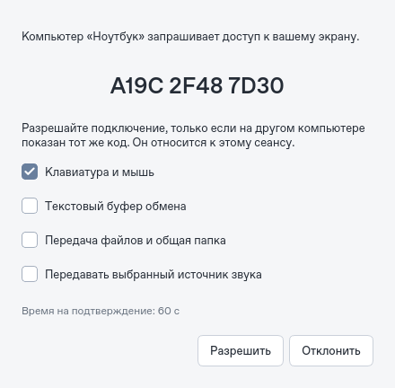
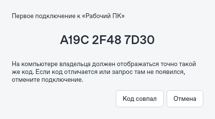
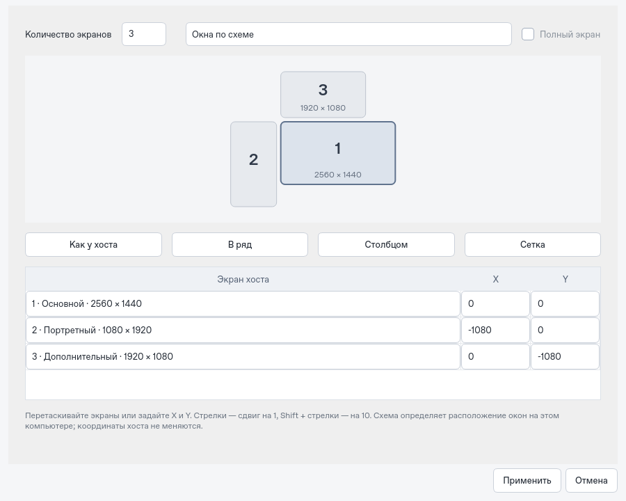

<div align="center">


<h1>VirtualKVM</h1>

<p>Изображение, звук, клавиатура, мышь и файлы между Windows и macOS по локальной сети.</p>

<p>
  <a href="https://github.com/Suqesse/VirtualKVM/actions/workflows/ci.yml"></a>
  <a href="https://www.python.org/downloads/"></a>
  <a href="docs/TESTING.md"></a>
  <a href="LICENSE"></a>
</p>

<p>
  <a href="https://github.com/Suqesse/VirtualKVM/releases/latest">Скачать</a> ·
  <a href="#быстрый-старт">Начать</a> ·
  <a href="docs/GUIDE.md">Руководство</a> ·
  <a href="docs/ARCHITECTURE.md">Архитектура</a> ·
  <a href="docs/TESTING.md">Проверки</a> ·
  <a href="https://github.com/Suqesse/VirtualKVM/actions">Сборки</a>
</p>


</div>

## Что умеет

| | Возможности |
| :--- | :--- |
| **Подключение** | Автоматический поиск открытых приложений в LAN, выбор компьютера по имени, подтверждение короткого кода без ввода PIN и отпечатка. |
| **Экраны** | От 1 до 8 экранов: схема окон с перетаскиванием, назначение локальным мониторам, полноэкранный режим. |
| **Изображение и звук** | H.264 / HEVC, AAC, синхронное A/V-воспроизведение и выбор доступного аппаратного кодера. |
| **Качество** | Профили «Игры · 240 FPS», «Работа · 60 FPS», «Качество · 4K», родное и пользовательское разрешение. |
| **Управление** | Клавиатура и мышь из активного окна, освобождение клавиш при потере фокуса, аварийный возврат управления. |
| **Файлы** | Передача файлов и браузер выбранной общей папки: чтение по умолчанию, запись по отдельному разрешению. |
| **Удобство** | Русский интерфейс, текстовый буфер обмена по выбору пользователя, сохранение профиля без PIN и паролей. |
| **Защита** | TLS, короткий код конкретного сеанса, явные права владельца, запоминание ключей; TCP-видео по умолчанию и SRT по выбору. |

**Статус: пилотная версия 0.3.0.** Цель — 240 FPS; фактическая частота зависит от захвата, разрешения, кодера, сети и мониторов. Поддержка параметра 240 FPS не означает подтверждённые два экрана 4K/240 FPS. [Что проверено →](docs/TESTING.md)

<details>
<summary><strong>Посмотреть режим хоста</strong></summary>


</details>

<details>
<summary><strong>Подтверждение первого подключения</strong></summary>

Сверьте один и тот же короткий код на двух компьютерах. Эти снимки показывают пример интерфейса, а не действующий код подключения.




</details>

<details>
<summary><strong>Настройка экранов</strong></summary>



Пример конфигурации. Приложение передаёт существующие экраны хоста; новые виртуальные дисплеи в ОС не создаются. [Как настроить →](docs/GUIDE.md#экраны-и-расположение)

</details>

## Быстрый старт

### Установить приложение

| Система | Архитектура | Установщик | Образ диска |
| --- | --- | --- | --- |
| Windows | x64 · Intel / AMD | [Скачать EXE](https://github.com/Suqesse/VirtualKVM/releases/download/v0.3.0/VirtualKVM-0.3.0-windows-x64-setup.exe) | — |
| macOS 15+ | Apple Silicon | [Скачать PKG](https://github.com/Suqesse/VirtualKVM/releases/download/v0.3.0/VirtualKVM-0.3.0-macos-arm64.pkg) | [Скачать DMG](https://github.com/Suqesse/VirtualKVM/releases/download/v0.3.0/VirtualKVM-0.3.0-macos-arm64.dmg) |
| macOS 15+ | Intel | [Скачать PKG](https://github.com/Suqesse/VirtualKVM/releases/download/v0.3.0/VirtualKVM-0.3.0-macos-x86_64.pkg) | [Скачать DMG](https://github.com/Suqesse/VirtualKVM/releases/download/v0.3.0/VirtualKVM-0.3.0-macos-x86_64.dmg) |

Python и FFmpeg входят в установщик. Для Mac выберите PKG **или** DMG своей архитектуры. [Последний релиз →](https://github.com/Suqesse/VirtualKVM/releases/latest) · [Пошаговая инструкция →](docs/INSTALLERS.md)

Нативные пакеты проходят сборку и проверку установки в [Installers](https://github.com/Suqesse/VirtualKVM/actions/workflows/installers.yml). Пилотные пакеты выпускаются без доверенной подписи, пока владелец проекта не добавит сертификаты.

### Запустить из исходников

Нужны **Python 3.11+** и **FFmpeg с SRT**. Установите FFmpeg по [инструкции для вашей ОС](docs/GUIDE.md#установка-из-исходников); `ffmpeg` и `ffprobe` должны быть доступны в `PATH`.

```bash
git clone https://github.com/Suqesse/VirtualKVM.git
cd VirtualKVM
```

Создайте и активируйте окружение:

<details>
<summary>Windows · PowerShell</summary>

```powershell
py -3 -m venv .venv
.\.venv\Scripts\Activate.ps1
```

</details>

<details>
<summary>macOS / Linux · Terminal</summary>

```bash
python3 -m venv .venv
source .venv/bin/activate
```

</details>

Установите зависимости и запустите приложение:

```bash
python -m pip install -r requirements.lock
python -m pip install --no-deps -e .
python -m virtualkvm doctor
python -m virtualkvm
```

### Первое подключение

1. Установите **0.3.0 на оба компьютера** одной локальной сети и откройте приложение. В Windows разрешите VirtualKVM доступ к частной сети при запросе ОС.
2. В списке **«Компьютеры в сети»** выберите нужный ПК и нажмите **«Подключиться»**. Адрес, порт, PIN и длинный отпечаток вводить не нужно.
3. При первом подключении сверьте короткий код на двух экранах: владелец нажимает **«Разрешить»**, подключающийся — **«Код совпал»**. Следующие подключения к знакомому ключу требуют подтверждения владельца.
4. Окна экранов появляются сразу. Для полного экрана нажмите **F11** или назначьте источники локальным мониторам в **«Настроить…»**.
5. Владелец отдельно разрешает ввод, звук, буфер обмена и файлы. Кнопка **«Прекратить сеанс»** на хосте отзывает подключение.

Поиск использует Bonjour/mDNS. Если он недоступен, раскройте **«Подключиться по адресу…»** и введите только IP и порт: первое подключение также подтверждается коротким кодом. Видео по умолчанию использует исходящие TLS/TCP-соединения — отдельные входящие UDP-порты на клиенте не нужны.

**Вернуть управление: `Ctrl` + `Alt` + `Shift` + `Escape`.** На macOS Alt соответствует Option.

Для обратного направления поменяйте роли компьютеров. Разрешения macOS, настройка системного звука, брандмауэр и работа с файлами описаны в [полном руководстве](docs/GUIDE.md).

## Совместимость

| Платформа | Назначение | Проверка |
| :--- | :--- | :--- |
| **Windows** | Хост и клиент; GDI-захват, SendInput, DirectShow-аудио. | Нативные API требуют проверки на реальном ПК. |
| **macOS** | Хост и клиент; AVFoundation, Quartz, VideoToolbox. | Нужны разрешения ОС и проверка на реальном Mac. |
| **Linux** | Разработка, синтетические хосты и клиентские проверки. | 189 автоматических тестов, A/V и проверка распакованной сборки прошли. |

Для системного звука может понадобиться Stereo Mix / виртуальный аудиокабель на Windows или loopback-устройство на macOS. Общая папка работает внутри приложения; системный диск SMB/NFS не монтируется. [Возможности и ограничения →](docs/GUIDE.md)

## Проверки и сборки

```bash
# Тесты, интерфейс, несколько видеопотоков, звук, ввод и файлы
python scripts/validate.py

# Создать приложение на текущей ОС
python -m pip install -e ".[build]"
python scripts/package.py
```

Локальная проверка: **189 тестов прошли; один нативный сценарий выполняется только на Windows**. Доступны [отчёт с хешами исходников](docs/validation/linux-0.3.0.json) и [матрица аппаратных проверок](docs/TESTING.md). A/V-тесты используют выключенную громкость; реальный аудиовыход и физическая задержка требуют отдельного измерения.

[Installers](https://github.com/Suqesse/VirtualKVM/actions/workflows/installers.yml) собирает автономные Windows Setup и macOS PKG/DMG со встроенным FFmpeg. [Test](https://github.com/Suqesse/VirtualKVM/actions/workflows/ci.yml) проверяет Windows, macOS и Linux и сохраняет обычные PyInstaller-архивы без FFmpeg в **Artifacts**. PyInstaller собирает приложение для той ОС, на которой запущен.

## Документация

| | |
| :--- | :--- |
| [Руководство](docs/GUIDE.md) | Установка, подключение, звук, разрешения, сеть, файлы и общая папка. |
| [Установщики](docs/INSTALLERS.md) | Windows Setup, macOS PKG/DMG, обновление и удаление. |
| [Архитектура](docs/ARCHITECTURE.md) | Компоненты, протоколы, границы доступа и медиатракт. |
| [Тестирование](docs/TESTING.md) | Автоматические проверки и сценарии для реального оборудования. |
| [Участие в разработке](CONTRIBUTING.md) | Окружение, тесты и оформление изменений. |
| [История изменений](CHANGELOG.md) | Состав пилотной версии. |
| [Зависимости и лицензии](docs/THIRD_PARTY_NOTICES.md) | Qt, FFmpeg и другие компоненты. |

Нашли проблему? [Создайте issue](https://github.com/Suqesse/VirtualKVM/issues/new/choose), указав ОС, оборудование и результат `doctor`. PIN, ключи и содержимое личных файлов прикладывать не нужно.

---

<div align="center">
Код приложения — <a href="LICENSE">MIT</a>. У сторонних компонентов собственные лицензии.
</div>
