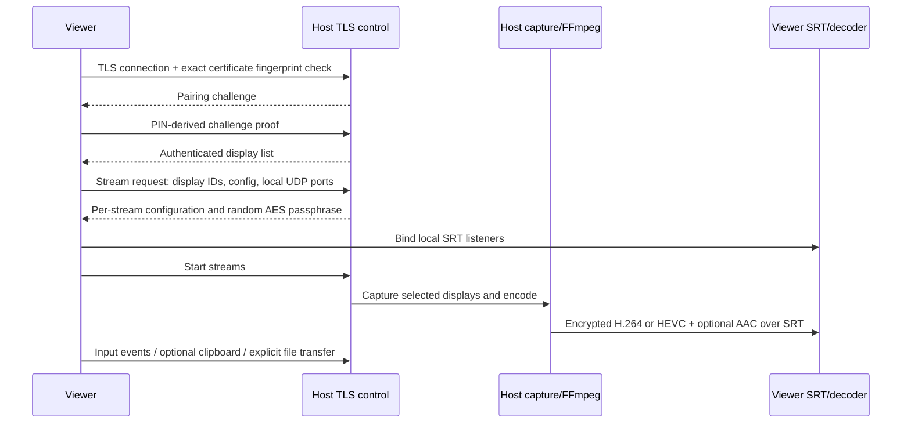

# Architecture

VirtualKVM 0.1.0 is a pilot application that separates the desktop control plane from media transport. Python coordinates platform APIs, networking, and the PySide6 interface; FFmpeg supplies native capture, H.264/HEVC encoding, AAC, SRT, decoding, and remuxing. The application does not implement a display driver.

## Components

| Module | Responsibility |
| --- | --- |
| `app.py` | Host/viewer lifecycle, stream negotiation, receiver ports, native input, cleanup |
| `control.py` | Framed TLS messages, authenticated sessions, events, clipboard, files, shared-folder browser, stream RPC |
| `security.py` | Persisted host certificate, SHA-256 certificate fingerprint, pairing proof |
| `media.py` | FFmpeg discovery, audio/video capture, encrypted SRT sender, RGB receiver and timestamp-preserving A/V relay |
| `native.py` | Display enumeration, Windows/macOS input injection, release of held input, platform permissions |
| `gui.py` | Russian host/connect interface, profiles, video/A/V windows, explicit input/clipboard and shared-folder controls |
| `__main__.py` | GUI entry point, diagnostics, headless host, synthetic smoke test |

The GUI forwards worker-thread callbacks through Qt-safe mechanisms. Video-only RGB frames use a bounded latest-frame path, so a slow display cannot create an unbounded backlog. Deliberately dropping stale presentation frames is separate from corrupting encoded video or silently duplicating frames in an integrity check. When audio is enabled, a QtMultimedia player consumes the timestamped muxed A/V stream instead of independently scheduling audio alongside RGB callbacks.

## Connection and streams

The host derives the video destination from the authenticated control peer rather than trusting an arbitrary destination supplied by a message. Each display has its own stream and encryption key. Control is carried on TCP, default port 24800; video uses negotiated UDP ports at the viewer.

Only an authenticated controlling session may inject input or negotiate streams. Replacing or losing that session tears down its streams and releases held input. Focus loss and the emergency shortcut also request input release. Network-loss handling must be bounded by the protocol's heartbeat/disconnect handling, not by waiting indefinitely for a user action.

## Trust and framing

The host generates a local certificate and persists its private key in its state directory. The viewer must obtain the certificate's SHA-256 fingerprint from the trusted host and verify it before sending pairing credentials. A self-signed certificate alone is not a reason to skip server identity verification. The PIN authorizes a controlling connection; its challenge proof is bound to a fresh challenge inside the encrypted channel.

JSON control frames are length-limited. Input events, dimensions, display identifiers, and receiver ports are validated. Files use bounded chunks, declared sizes, and a final SHA-256 check. The receiver uses a safe basename, a temporary file, and completion before exposing the result; existing files must not be silently overwritten. Clipboard messages contain bounded text and require an explicit GUI opt-in before applying it locally.

The optional shared directory is a host-selected root and is read-only by default. Authenticated RPC supports directory listing and downloads; uploads and directory creation require a separate host write opt-in. Paths are relative POSIX paths rooted inside the share. Traversal, absolute/backslash paths, symlinks, Windows reparse points, POSIX hard links and special files are rejected. The state/identity directory and overlapping roots cannot be shared. Listings are limited to 2048 entries and individual transfers to 1 GiB using chunks of at most 64 KiB. File exchange is an application browser, not an SMB/NFS service or kernel-mounted drive.

The TLS-protected stream negotiation carries independent random SRT passphrases. FFmpeg command execution uses argument arrays without a shell, and diagnostics must redact passphrases. User PINs and certificate private keys must not be copied into repository files, saved setup scripts, or public logs.

## Native capture and input

Windows uses FFmpeg `gdigrab` for desktop capture and `SendInput` for input. Display geometry is used to map normalized pointer coordinates onto the target monitor in the Windows virtual desktop. DDC/CI support, where available, is a separate monitor-configuration operation.

macOS uses FFmpeg AVFoundation screen devices for capture and Quartz event APIs for input. The display list and AVFoundation device list are separate namespaces and must be mapped deliberately. macOS TCC permissions apply to capture and Accessibility independently; missing permission is a diagnosable prerequisite, not a reason to fake successful capture or injection.

Linux supports the synthetic capture and dry-run input path used by development checks. This does not imply Linux native desktop support.

## Audio and synchronization

Audio is an explicit opt-in and is carried with the first selected display only. Windows uses a chosen DirectShow input, such as Stereo Mix or a virtual cable, alongside screen capture. FFmpeg common wall-clock timestamps and input synchronization align these inputs; AAC output uses asynchronous resampling. macOS combines the selected AVFoundation screen and audio device in one A/V input. Capturing system output on macOS typically requires a separately installed loopback device such as BlackHole; a microphone is a different source, not a system-audio fallback.

Synthetic mode combines testsrc2 video and a 48 kHz sine source encoded as stereo AAC. A receiving FFmpeg process remuxes the media without discarding its presentation timestamps and exposes MPEG-TS on an ephemeral loopback HTTP endpoint. QtMultimedia `QMediaPlayer`, `QVideoWidget` and `QAudioOutput` then use one playback clock. The relay is local infrastructure, not a user-facing web preview or public server.

Preserved timestamps and a shared player clock establish the synchronization mechanism. They do not by themselves measure physical audio/video alignment, end-to-end latency, or long-running drift through a particular output device. Native and real-device tests remain separate from synthetic mux/relay tests.

## Configuration limits and profiles

Stream width and height are integers from 1 through 16384. Odd dimensions are rounded up for codec input by padding the right/bottom edge, with a coded-area limit of 67,108,864 pixels. The RGB receiver crops back to the requested viewport. A/V playback may show the extra one-pixel edge because it presents the coded video. A codec or GPU can impose tighter limits than configuration validation.

Frame rate is 1–240 FPS, bitrate is 1–500 Mbit/s per stream, and SRT latency is 10–2000 ms. The source-resolution option is resolved on the host separately for each selected display. Custom output dimensions scale captured pixels; they do not create virtual displays or raise a physical monitor's refresh rate.

GUI profiles are Gaming (1920×1080/240 FPS, 45 Mbit/s, 30 ms SRT), Office (1920×1080/60 FPS, 16 Mbit/s, 60 ms), and Quality (3840×2160/60 FPS, 60 Mbit/s, 60 ms), plus a custom profile. Non-secret preferences may persist; PINs, stream keys, and trusted certificate fingerprints are not persisted as ordinary GUI preferences.

## Performance target and validation

The preferred target is **240 FPS**. At this rate one frame lasts approximately 4.17 ms. Resolution, number of monitors, encoder limits, buffering, network capacity, decoding, and physical display refresh all constrain the attainable result. A configured or probed 240 FPS stream does not establish a 240 FPS physical capture/display pipeline.

The synthetic tests exercise software encoding, encrypted transport, decoding, and integrity under controlled conditions. TLS, pairing, input event routing, clipboard, files, disconnect cleanup, and invalid requests are tested separately. Native Windows/macOS behavior and sustained dual-monitor throughput require tests on actual target machines.

Hardware encoders are selected only when usable; a listed FFmpeg encoder may still fail when its driver or device is unavailable. Software fallback must be visible. No automatic benchmark result should be presented as a claim of dual 4K/240 FPS or a measured end-to-end latency unless that exact path was measured.

## Packaging

`scripts/package.py` builds with PyInstaller on the current OS. It generates a launcher under `build/packaging` and application output under `dist`, leaving application source unchanged. On macOS it adds capture/microphone/input purpose descriptions to the generated `BUNDLE` configuration before PyInstaller creates/seals the app; it never mutates a sealed `Info.plist` afterward. These strings do not grant TCC permissions. `--bundle-ffmpeg` stages FFmpeg, ffprobe and their native dependency closure with an empty-PATH functional check; plain builds use external media tools. Loopback audio drivers remain external prerequisites. Native installer builds use Inno Setup on Windows and pkgbuild/productbuild/hdiutil on macOS. Existing macOS keychain identities and a notarization profile can be supplied; no certificates are included. See [installer recipes and native checks](INSTALLERS.md).

Application MIT text, a dependency notice, and available installed dependency license files are included under `licenses/` in bundled resources. See [THIRD_PARTY_NOTICES.md](THIRD_PARTY_NOTICES.md). CI is configured to run checks, build and upload platform artifacts; whether a particular remote run succeeded must be established from that run, not inferred from the workflow file.

The complete test matrix, including hardware-only checks, is in [TESTING.md](TESTING.md).
